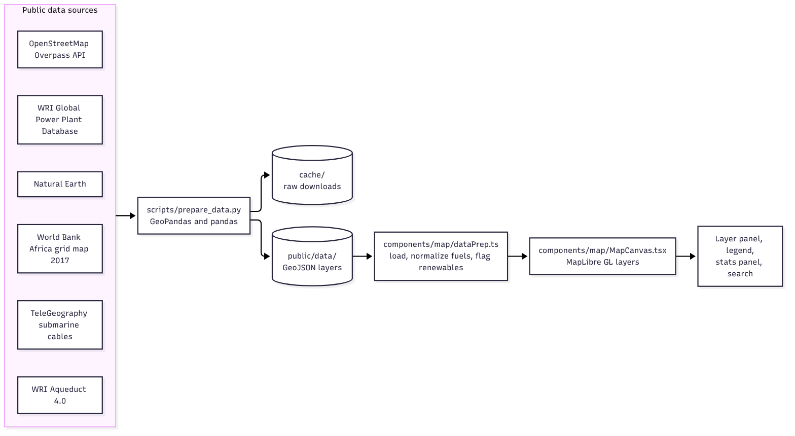

# MapKwetu

MapKwetu brings together Africa’s energy and digital infrastructure for exploration and focused research. It includes a public landing page, an interactive atlas, source notes, and a project-enquiry brief builder.

**Website:** https://africapowergrid.vercel.app/

**Interactive atlas:** https://africapowergrid.vercel.app/atlas

The repository retains its original `Africa-Power-Atlas` name. The product is branded MapKwetu.

## Pages and enquiries

- `/`: MapKwetu introduction, research offerings, and project brief builder.
- `/atlas`: the existing interactive infrastructure map, filters, and analytics.
- `/sources`: dataset sources, coverage, methods, and limitations.

The enquiry form always downloads a text brief on the visitor’s device. To also prepare an email draft addressed to your business, set `MAPKWETU_CONTACT_EMAIL` in `.env.local` and in the hosting environment, then rebuild. The address is intentionally shown to visitors through their mail client, so use a public business inbox. Without it, the form clearly states that it only downloads a brief and sends nothing. No visitor data is stored by this form, and no email is sent automatically. The visitor reviews and sends the prepared email in their email app.

Research and custom dashboards are offered by enquiry. This release does not implement subscriptions, payment collection, customer accounts, or an automated report-delivery service.

The homepage illustration is generated from the committed Natural Earth boundaries and WRI plant records. It represents that dataset rather than complete current infrastructure coverage. To regenerate it after refreshing the data, run `python scripts/build_marketing_map.py`.

## Architecture



The project has two parts. A Python script downloads the public datasets, clips them to Africa and writes clean GeoJSON files. A Next.js app then loads those files in the browser and draws them with MapLibre GL.

## What the map shows

| Layer | Source |
|---|---|
| Power plants | WRI Global Power Plant Database |
| Transmission lines | World Bank Africa Electricity Transmission and Distribution Grid Map (2017) |
| Planned upgrades | Derived from the transmission layer |
| Substations | OpenStreetMap, through the Overpass API |
| Submarine cables | TeleGeography Submarine Cable Map |
| Data centers | OpenStreetMap plus a curated list of major sites |
| Water stress | WRI Aqueduct 4.0 country rankings |
| Countries, provinces, place labels | Natural Earth |

## Features

- Filter power plants by fuel type, or show renewables only
- View plants as points, clusters or a heatmap
- Search by country or region
- Six basemap themes: Dark, Light, Streets, Hybrid, Satellite and Minimal
- Stats panel and map legend

## Run it locally

You need Node.js. Python 3 is optional and is used to refresh the datasets.

```bash
git clone https://github.com/Ambuso/Africa-Power-Atlas.git
cd Africa-Power-Atlas

npm ci
pip install geopandas pandas requests   # only needed to refresh datasets

npm run prepare:data   # optional: refresh the committed data in public/data/
npm run dev            # http://localhost:3000
```

Prepared GeoJSON files are committed in `public/data/`, so you can start the app without running Python. Python 3 and the listed Python packages are only needed to refresh the datasets. The substations step queries OpenStreetMap and can take a few minutes.

The browser loads enabled layers on demand and reuses successful results during the session. Country and province boundaries also load when place labels need them. Plants appear before larger layers finish loading. Failed layers show an error with a Retry button; successful layers remain available. Browser HTTP caching follows the hosting server’s cache headers.

Useful options for the data script:

```bash
python scripts/prepare_data.py --only plants,transmission   # run selected steps
python scripts/prepare_data.py --force                      # ignore the cache and download again
```

### Basemaps

The map works without any API key. The default Dark and Minimal basemaps are built from Natural Earth layers committed in `public/basemap/` (rebuild with `python scripts/build_basemap.py`), with terrain shading from AWS Terrain Tiles. Light and Streets use free OpenFreeMap styles; Hybrid and Satellite use Esri World Imagery.

Optional: add `NEXT_PUBLIC_MAPTILER_KEY=` to `.env.local` to use MapTiler for Light and Streets instead.

## Project structure

```
app/                  Next.js pages and global styles
components/map/       map canvas, layers, themes, legend, data loading
components/sidebar/   layer and filter panel
components/panels/    stats panel
components/topbar/    search and view mode
lib/                  shared types and country list
scripts/              prepare_data.py, the data pipeline
```

## Built with

Next.js, React, TypeScript, MapLibre GL, Tailwind CSS, Python, GeoPandas


## Checks

```bash
npm test             # loading, map control, and enquiry regression tests
npm run typecheck    # TypeScript checks
npm run build        # production build
```

GitHub Actions runs these checks for pushes and pull requests to `main`.
